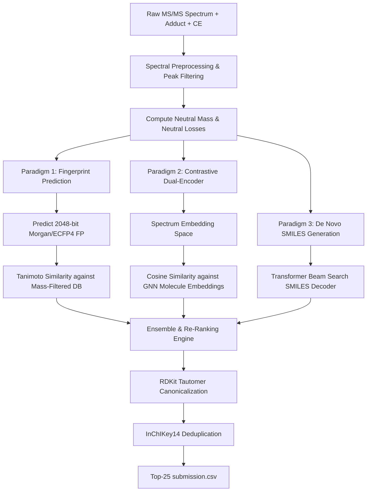

# Enveda CASMI 2026: Molecule ID From Mass Spectra 🔬🧪

[](https://www.kaggle.com/competitions/enveda-CASMI26-molecule-id-mass-spectra)
[](https://www.kaggle.com/competitions/enveda-CASMI26-molecule-id-mass-spectra/overview/evaluation)
[](https://www.python.org/)
[](https://www.rdkit.org/)
[](https://pytorch.org/)

A production-grade machine learning and cheminformatics repository for the **[Enveda CASMI 2026 - Molecule ID From Mass Spectra](https://www.kaggle.com/competitions/enveda-CASMI26-molecule-id-mass-spectra)** Kaggle competition.

---

## 📌 Table of Contents
- [Competition Overview](#-competition-overview)
- [Scientific Background & Challenge](#-scientific-background--challenge)
- [Dataset Architecture & Schema](#-dataset-architecture--schema)
- [Evaluation Metric (MRR@25)](#-evaluation-metric-mrr25)
- [Submission Requirements](#-submission-requirements)
- [Modeling Paradigms & Strategies](#-modeling-paradigms--strategies)
- [Repository Structure](#-repository-structure)
- [Quickstart & Installation](#-quickstart--installation)
- [Usage Workflow](#-usage-workflow)
- [Cross-Validation & Engineering Tips](#-cross-validation--engineering-tips)
- [References & Acknowledgements](#-references--acknowledgements)

---

## 📖 Competition Overview

In non-targeted biological and metabolomic studies, tandem mass spectrometry ($\text{MS/MS}$) detects thousands of molecular features. However, **over 90% of observed peaks remain uncharacterized "dark matter"** because they do not match entries in experimental reference libraries.

The **Enveda CASMI 2026** challenge, organized by **Enveda Biosciences** in partnership with founders of the **Critical Assessment of Small Molecule Identification (CASMI)**, tasks participants with predicting the 2D chemical structure (represented as SMILES strings) of unknown small molecules using only their $\text{MS/MS}$ spectra and precursor metadata.

- **Prize Pool**: $50,000 USD (Top 5 teams: $16k, $12k, $10k, $7k, $5k)
- **Format**: Kaggle Code Competition (Notebook execution with hidden test set)
- **Challenge Types**:
  - **Class 1 (Library)**: Molecules represented in public chemical/spectral libraries.
  - **Class 2 (Analogs)**: Structural analogs and close scaffolds of known compounds.
  - **Class 3 (*De Novo*)**: Completely novel chemical structures requiring *de novo* generation or unbiased retrieval.

---

## 🔬 Scientific Background & Challenge

Tandem mass spectrometry ($\text{MS/MS}$ or $\text{MS}^2$) operates through a multi-stage process:

```
[ Sample Extract ] 
       │
       ▼ (Electrospray Ionization - ESI)
[ Precursor Ion (MS1) ]  ───► Records precursor m/z and adduct ([M+H]+, [M-H]-, etc.)
       │
       ▼ (Collision-Induced Dissociation - CID at specified Collision Energy)
[ Fragment Ions (MS2) ]  ───► Records fragment m/z array & normalized intensity array
       │
       ▼ (Neutral Loss)
[ Precursor m/z - Fragment m/z ] ───► Loss of functional groups (H2O, CO2, sugars, etc.)
```

### The In Silico Elucidation Dilemma
1. **Constitutional Isomers**: Thousands of distinct chemical structures share the exact same chemical formula and precursor mass.
2. **Fragmentation Nonlinearity**: Collision-induced dissociation induces complex rearrangement reactions, hydrogen transfers, and ring closures.
3. **Collision Energy Variations**: Spectra vary substantially across different instrument energies (e.g. 10 eV vs 60 eV).

---

## 📊 Dataset Architecture & Schema

The dataset provides ~2.5 million $\text{MS/MS}$ spectra covering ~275,000 unique chemical structures, including public spectra and the **Enveda-180** dataset (1.16 million spectra across 184,330 synthetic molecules).

### Files Provided
- `train.parquet`: Training spectra with ground-truth normalized SMILES.
- `test.parquet`: Test spectra for prediction (`normalized_smiles` hidden).
- `sample_submission.csv`: Template demonstrating submission schema.

### Column Specifications
| Column Name | Type | Description |
| :--- | :--- | :--- |
| `molecule_id` | String | Unique identifier for the compound |
| `precursor_mz` | Float64 | High-resolution mass-to-charge ($m/z$) ratio of isolated parent ion |
| `adduct` | String | Ionization species (e.g., `[M+H]+`, `[M+Na]+`, `[M-H]-`, `[M+HCOO]-`) |
| `collision_energy` | Varied | Dissociation collision energy (eV or normalized collision energy) |
| `ms2_mzs` | List[Float64] | Array of fragment ion mass-to-charge values |
| `ms2_normalized_intensities` | List[Float64] | Normalized detector abundances aligned with `ms2_mzs` |
| `normalized_smiles` | String | Canonical 2D structure SMILES (*training set only*) |

---

## 🎯 Evaluation Metric (MRR@25)

Submissions are evaluated on **Mean Reciprocal Rank @ 25 ($\text{MRR@25}$)** using **InChIKey14** matching.

### 1. InChIKey14 & Tautomer Canonicalization
- Candidate SMILES and ground truth structures are processed with **RDKit**:
  ```python
  from rdkit import Chem
  from rdkit.Chem.MolStandardize import rdMolStandardize

  mol = Chem.MolFromSmiles(smiles)
  canon_mol = rdMolStandardize.TautomerEnumerator().Canonicalize(mol)
  inchikey14 = Chem.MolToInchiKey(canon_mol)[:14]
  ```
- **Why InChIKey14?** The first 14 characters encode planar molecular skeleton and atom connectivity, disregarding stereocenters and cis/trans isomerism (which CID MS/MS cannot distinguish).

> [!WARNING]
> **Deduplicate on InChIKey14!**
> Submitting stereoisomers or tautomers that share the same InChIKey14 will consume candidate slots without improving your score. Always deduplicate candidate lists using InChIKey14 before submitting.

### 2. Reciprocal Rank Calculation
For each test molecule $i$, if the ground truth InChIKey14 matches the candidate at 1-based rank $r_i \in \{1, 2, \dots, 25\}$:
$$\text{RR}_i = \frac{1}{r_i}$$
If no candidate in the top 25 matches the ground truth, $\text{RR}_i = 0$.

The overall score is:
$$\text{MRR@25} = \frac{1}{N} \sum_{i=1}^N \text{RR}_i$$

| Candidate Rank ($r$) | Reciprocal Rank Score | Relative Value |
| :---: | :---: | :---: |
| **Rank 1** | **1.0000** | 100% |
| **Rank 2** | **0.5000** | 50% |
| **Rank 3** | **0.3333** | 33.3% |
| **Rank 5** | **0.2000** | 20% |
| **Rank 10** | **0.1000** | 10% |
| **Rank 25** | **0.0400** | 4% |
| **> 25** | **0.0000** | 0% |

Precision at Rank 1 is 25x more rewarding than Rank 25!

---

## 📝 Submission Requirements

- **File Name**: `submission.csv`
- **Delimiter**: Semicolon (`;`) between candidate SMILES strings.
- **Max Candidates**: Up to 25 candidates per `molecule_id`.
- **Ordering**: Best guess first (descending confidence).

### Example Format
```csv
molecule_id,smiles
m_0014ef,CC1=CC(=O)C=CC1=O;OC(=O)c1ccccc1O;CN1C=NC2=C1C(=O)N(C)C(=O)N2C
m_004d06,NCCc1ccc(O)cc1;CC(=O)Nc1ccc(O)cc1;OCC(O)CO
```

---

## 🧠 Modeling Paradigms & Strategies

This repository supports three primary machine learning paradigms for MS/MS structure elucidation:



1. **Fingerprint Prediction & Tanimoto Retrieval** (`src/models/baseline.py`):
   - Maps binned spectra and neutral mass to 2048-bit Morgan/ECFP fingerprint probabilities.
   - Computes continuous Tanimoto similarity against database candidates filtered within $\pm 10$ ppm mass tolerance.
2. **Contrastive Dual-Encoder**:
   - Spectrum Encoder (Set Transformer / 1D Conv) and Molecule Encoder (GNN / MolFormer) trained with InfoNCE contrastive loss.
3. **De Novo Autoregressive Generation**:
   - Sequence-to-sequence model (Mass2SMILES / Spec2Mol) generating SMILES tokens directly from sorted $(m/z, \text{intensity})$ peak tokens.

---

## 📂 Repository Structure

```
.
├── .gitignore                      # Git ignore for data, checkpoints, and logs
├── requirements.txt                # Python package dependencies
├── README.md                       # Comprehensive project documentation
├── src/
│   ├── __init__.py                 # Root package initialization
│   ├── metric.py                   # Official MRR@25 evaluation metric implementation
│   ├── data/
│   │   ├── __init__.py
│   │   ├── dataset.py              # Polars & PyTorch Dataset for parquet spectra
│   │   └── preprocess.py           # Peak filtering, binning, and CE normalization
│   ├── models/
│   │   ├── __init__.py
│   │   └── baseline.py             # Spectrum encoder, FP predictor & re-ranker
│   └── utils/
│       ├── __init__.py
│       └── chem.py                 # RDKit canonicalization, InChIKey14 & deduplication
└── scripts/
    ├── evaluate.py                 # Offline validation evaluation CLI
    └── make_submission.py          # Submission generator & format validator
```

---

## ⚡ Quickstart & Installation

### 1. Clone & Set Up Environment
```bash
git clone https://github.com/tanish-ml/enveda-casmi-2026.git
cd enveda-casmi-2026

# Create and activate virtual environment
python -m venv .venv
# Windows:
.venv\Scripts\activate
# Linux/macOS:
# source .venv/bin/activate

# Install dependencies
pip install -r requirements.txt
```

### 2. Download Competition Data via Kaggle CLI
Ensure your `kaggle.json` API token is in `~/.kaggle/`:
```bash
kaggle competitions download -c enveda-CASMI26-molecule-id-mass-spectra -p data/
cd data && unzip enveda-CASMI26-molecule-id-mass-spectra.zip && cd ..
```

---

## 🚀 Usage Workflow

### 1. Preprocess & Load Dataset in Python
```python
import polars as pl
from src.data.dataset import MassSpectraDataset

# Load dataset
train_ds = MassSpectraDataset(
    df="data/train.parquet",
    max_peaks=300,
    binned=True,
    bin_size=0.5
)

sample = train_ds[0]
print(f"Molecule ID: {sample['molecule_id']}")
print(f"Precursor m/z: {sample['precursor_mz']}, Adduct: {sample['adduct']}")
print(f"Spectrum shape: {sample['spectrum'].shape}")
if "smiles" in sample:
    print(f"SMILES: {sample['smiles']}")
    print(f"InChIKey14: {sample['inchikey14']}")
```

### 2. Evaluate Offline Model Predictions
```bash
python scripts/evaluate.py \
    --val-file data/val.parquet \
    --pred-file submissions/val_predictions.csv \
    --max-k 25
```

Output:
```
==================================================
           OFFICIAL EVALUATION RESULTS            
==================================================
  MRR@25 (Leaderboard Metric): 0.42850
  Top-1 Accuracy:               34.20%
  Top-5 Accuracy:               56.10%
  Top-10 Accuracy:              68.40%
  Top-25 Accuracy:              79.80%
  Total Samples Evaluated:      10000
==================================================
```

### 3. Generate Validated Submission File
```bash
python scripts/make_submission.py \
    --test-file data/test.parquet \
    --candidates-file submissions/raw_candidates.json \
    --output submission.csv \
    --max-candidates 25
```

---

## 💡 Cross-Validation & Engineering Tips

1. **Validation Split (Avoid Data Leakage!)**:
   - **Never use random K-Fold!** Multiple spectra can come from the exact same compound, constitutional isomers, or stereoisomers.
   - Use **GroupKFold** grouped by `InChIKey14` or **Murcko Scaffold Split** to ensure test molecules test generalization.
2. **Neutral Loss Features**:
   - Always calculate the neutral loss spectrum: $\Delta m/z = m/z_{\text{precursor}} - m/z_{\text{fragment}}$. Neutral losses provide direct signals for common functional groups (e.g. $-\text{H}_2\text{O}$, $-\text{CO}_2$, sugar moieties).
3. **Adduct-Aware Mass Filtering**:
   - Convert precursor $m/z$ to neutral monoisotopic mass $M$ using the adduct shift table in `src/utils/chem.py`.
   - Constrain candidate search to a narrow mass window ($\pm 10$ ppm) for dramatic speedup and precision.
4. **Collision Energy Conditioning**:
   - Normalize collision energy to continuous float eV and feed it as an explicit conditioning vector. High CE promotes deep fragmentation into small aromatic rings, whereas low CE preserves precursor fragments.

---

## 📚 References & Acknowledgements

- **Competition Page**: [Enveda CASMI 2026 Kaggle Challenge](https://www.kaggle.com/competitions/enveda-CASMI26-molecule-id-mass-spectra)
- **Host**: [Enveda Biosciences](https://www.envedabio.com/)
- **CASMI Initiative**: [Critical Assessment of Small Molecule Identification](http://casmi-contest.org/)
- **Cheminformatics**: [RDKit Open-Source Cheminformatics](https://www.rdkit.org/)
- **Mass Spectrometry**: [MatchMS](https://github.com/matchms/matchms), [MS-Entropy](https://github.com/Yuanyue-Li/ms-entropy)
